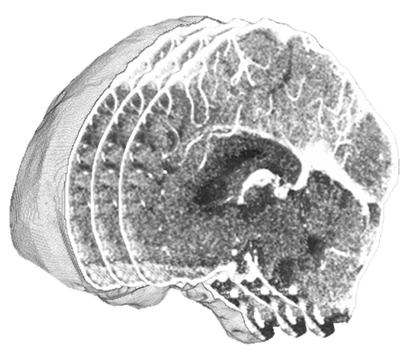
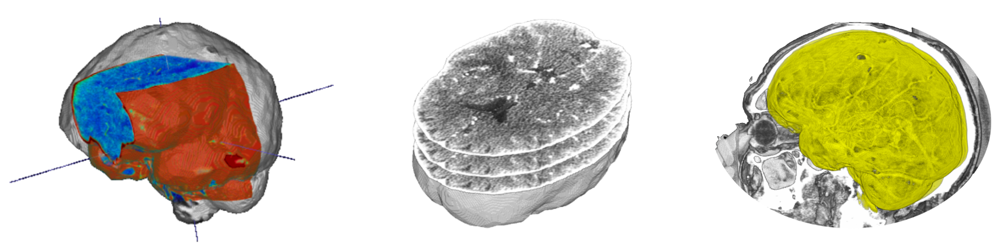

<div align="center">

  <!-- headline -->
  <center><h1> NIfTI Dataset Management</h1></center>

  <!-- PyPI badges -->
  <a href="https://pypi.org/project/nidataset/">
    
  </a>
  <a href="https://pepy.tech/project/nidataset">
    
  </a>
  <a href="https://pypi.org/project/nidataset/">
    
  </a>
  <a href="https://pypi.org/project/nidataset/">
    
  </a>

</div>

<br>

**NIfTI dataset toolkit for CT/MRI deep-learning pipelines: slice extraction, registration, QC, preprocessing — no ML dependencies.**

Official GitHub repository available [here](https://github.com/GiulioRusso/Ni-Dataset). <br>

## 🚀 Quick start

```bash
pip install nidataset            # add [yaml] for YAML pipeline / QC configs
```

```python
import nidataset as nid

print(nid.qc.check_dataset("scans/").status)  # orientation, spacing, NaN, ... before anything else
nid.resampling_dataset("scans/", "resampled/", desired_volume=(224, 224, 128), saving_mode="folder")
nid.extract_slices_dataset("resampled/", "slices/", view="axial", saving_mode="view")
nid.extract_annotations_dataset("labels/", "annotations/", view="axial", saving_mode="view")
```

Or describe the whole chain in one config and run it from the shell — see [Pipelines](pipeline/index.md):

```bash
nii run pipeline.yaml            # QC -> slices -> registration -> ... + run_manifest.json
```

## 🧭 Where to go next

| I want to… | Go to |
|------------|-------|
| Install, extras, FSL, templates | [Installation](installation.md) |
| Run a reproducible multi-step pipeline | [Pipelines (`nii run`)](pipeline/index.md) |
| Check a dataset before training | [Quality Control](qc/index.md) |
| Rotate / flip / crop / convert from the shell | [Quick Operations (`nii`)](nii/index.md) |
| Look up a function | [Package Functions](functions/index.md) |
| See what changed | [Changelog](https://github.com/GiulioRusso/Ni-Dataset/blob/main/CHANGELOG.md) |
| Cite nidataset | [`CITATION.cff`](https://github.com/GiulioRusso/Ni-Dataset/blob/main/CITATION.cff) |



Check [here](https://github.com/GiulioRusso/Python-tutorials/blob/main/NIfTI-Guide.md) for a complete NIfTI guide <br>

## 👨‍💻 Authors
- [Giulio Russo](https://www.linkedin.com/in/russogiulio/)
- [Ciro Russo, PhD](https://www.linkedin.com/in/ciro-russo-b14056100/)

## ⚖️ License

MIT License

