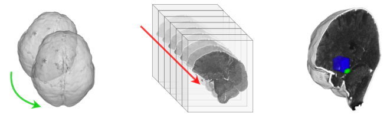

# 🔁 Pipelines (`nii run`)



Chain nidataset operations — QC, slice extraction, skull stripping, registration,
MIP, resampling — in **one config file** and run them with a single command.
Every run is validated up front and leaves a `run_manifest.json` behind, so you
know exactly which version, settings and outputs produced a dataset.

```bash
pip install "nidataset[yaml]"    # YAML configs (JSON works without the extra)
nii run pipeline.yaml
```

```python
import nidataset as nid

manifest = nid.run_pipeline("pipeline.yaml")
```

> **Note:** this replaces the former [CT-Manager](https://github.com/GiulioRusso/CT-manager) repository.
> See [Migrating from CT-Manager](#migrating-from-ct-manager).

## Try it in 10 seconds

The repository ships a complete example on synthetic data (two tiny "heads" with
a lesion, plus a template), so nothing real is needed:

```bash
git clone https://github.com/GiulioRusso/Ni-Dataset
cd Ni-Dataset/examples/ct_pipeline
pip install "nidataset[yaml]"
python make_synthetic.py        # writes ./data
nii run pipeline.yaml           # writes ./output and ./output/run_manifest.json
```

Source: [`examples/ct_pipeline/pipeline.yaml`](https://github.com/GiulioRusso/Ni-Dataset/blob/main/examples/ct_pipeline/pipeline.yaml).

## Config file

```yaml
dataset:                       # named inputs; relative paths resolve against this file
  images: data/images
  masks: data/masks
  annotations: data/annotations
  template: /path/to/MNI152_T1_1mm_brain.nii.gz
  template_mask: /path/to/MNI152_T1_1mm_brain_mask.nii.gz

output: output                 # run folder

steps:                         # executed top to bottom
  - op: qc_dataset
    dataset_path: "{images}"

  - op: extract_slices
    views: [axial, coronal, sagittal]   # one run per view
    nii_folder: "{images}"
    saving_mode: view
    save_stats: true

  - op: register
    nii_folder: "{images}"
    mask_folder: "{masks}"
    template_path: "{template}"
    template_mask_path: "{template_mask}"
    saving_mode: folder

  - op: register_mask           # reuses the transforms written by `register`
    mask_folder: "{masks}"
    transform_folder: "{output}/register/transforms"
    registered_folder: "{output}/register/registered"
    saving_mode: folder
```

| Key | Meaning |
|-----|---------|
| `dataset` | Named paths. Referenced in steps as `{name}`. |
| `output` | Run folder. Each step writes to `{output}/<step name>` unless it sets `output_path`. |
| `steps[].op` | Operation to run (table below). |
| `steps[].name` | Step name (default: the `op`). Required to be unique: name repeated ops, e.g. `name: extract_masks`. |
| `steps[].views` | Optional list of `axial` / `coronal` / `sagittal`: the step runs once per view, and `{view}` is available. |
| any other key | Passed as a keyword argument to the underlying nidataset function. Lists become tuples. |

**Placeholders** in string values: `{<dataset key>}`, `{output}`, `{view}`. Quote
them in YAML (`"{images}"`), otherwise YAML reads braces as a mapping. Later steps
read the outputs of earlier ones through `{output}/<step name>/...`.

## Operations

Each op is a thin name for an existing function, so that function's page is the
reference for its options.

| `op` | Function | Notes |
|------|----------|-------|
| `qc_dataset` | [`qc.check_dataset`](../qc/check_dataset.md) | `dataset_path` (folder or CSV), optional `config_path`. Writes `qc_dataset.json`. |
| `qc_volume` | [`qc.check_volume`](../qc/check_volume.md) | `nii_path`, optional `config_path`. Writes `<case>_qc.json`. |
| `extract_slices` | [`extract_slices_dataset`](../functions/slices/extract_slices_dataset.md) | |
| `extract_annotations` | [`extract_annotations_dataset`](../functions/slices/extract_annotations_dataset.md) | |
| `draw_annotations` | [`draw_2D_annotations`](../functions/draw/draw_2D_annotations.md) | Single image + CSV; use `{view}` to draw one per view. |
| `skull_strip` | [`skull_CTA_dataset`](../functions/preprocessing/skull_CTA_dataset.md) | Needs FSL (`bet`, `fslmaths`) on `PATH`. |
| `register` | [`register_CTA_dataset`](../functions/preprocessing/register_CTA_dataset.md) | Expects masks named `<case>_mask.nii.gz`. |
| `register_mask` | [`register_mask_dataset`](../functions/preprocessing/register_mask_dataset.md) | |
| `register_annotation` | [`register_annotation_dataset`](../functions/preprocessing/register_annotation_dataset.md) | Expects annotations named `<case>_bbox.nii.gz`. |
| `mip` | [`mip_dataset`](../functions/preprocessing/mip_dataset.md) | |
| `resample` | [`resampling_dataset`](../functions/preprocessing/resampling_dataset.md) | |

The list is also available in Python as `nid.pipeline.OPS`.

## Validation before anything runs

`nii run` checks the whole file first and reports **every** problem at once:
unknown ops, misspelled or missing arguments (checked against the function
signature), unknown placeholders, input paths that don't exist, `views` on an op
that can't use them, and FSL missing for `skull_strip`. Nothing is written until
the config is valid.

```text
error: invalid pipeline config:
  - step 'register' (register): got an unexpected keyword argument 'iterations'; accepted kwargs: [...]
  - step 'skull_strip': op 'skull_strip' needs ['fslmaths', 'bet'] on PATH (not found). Install FSL ...
```

Inputs that live under `output` are not required to exist yet: they are produced
by earlier steps.

## Rerunning part of a pipeline

```bash
nii run pipeline.yaml --only register,register_mask
```

```python
nid.run_pipeline("pipeline.yaml", only=["register", "register_mask"])
```

Selected steps run in config order. Outputs of skipped steps must already be on
disk.

## Run manifest

Each run writes `<output>/run_manifest.json`:

```json
{
  "nidataset_version": "0.9.0",
  "python": "3.12.4",
  "config": "/abs/path/pipeline.yaml",
  "config_sha256": "f165ad3e…",
  "output": "/abs/path/output",
  "only": null,
  "started": "2026-10-15T12:00:00+00:00",
  "finished": "2026-10-15T12:00:02+00:00",
  "status": "ok",
  "steps": [
    {
      "step": "extract_slices", "op": "extract_slices",
      "function": "nidataset.slices.extract_slices_dataset", "view": "axial",
      "kwargs": {"nii_folder": "/abs/path/data/images", "saving_mode": "view", "...": "..."},
      "status": "ok", "seconds": 0.05, "result": 64,
      "output_path": "/abs/path/output/extract_slices", "n_files": 65
    }
  ]
}
```

If a step fails, it is recorded with `"status": "failed"` and the `error`, the
manifest is written, and the run stops (`nii run` exits with code `2`).
`n_files` counts the files in the step's output folder after the call (steps with
`views` share a folder, so the count accumulates).

## Using real data

- **Layout**: images `<case>.nii.gz`, brain masks `<case>_mask.nii.gz`,
  annotations `<case>_bbox.nii.gz` (labelled boxes). Use one folder each.
- **Template**: FSL ships MNI152 templates in `$FSLDIR/data/standard/`
  (`MNI152_T1_1mm_brain.nii.gz`, `MNI152_T1_1mm_brain_mask.nii.gz`); point
  `template` / `template_mask` at them.
- **Registration settings**: the example overrides `number_iterations` and
  `metric_sampling_percentage` for its tiny volumes; drop them for real scans.
- **Skull stripping**: install [FSL](https://fsl.fmrib.ox.ac.uk/fsl/docs/#/install/index)
  and run from a terminal that sources FSL's profile (IDEs often don't). Paths
  with spaces are fine.
- **QC first**: keep `qc_dataset` as the first step; check `qc_dataset.json` for
  orientation or spacing outliers before trusting the rest of the run.

## Migrating from CT-Manager

CT-Manager's `configs/paths.yaml` becomes the `dataset:` block, and each `--task`
becomes a step:

| CT-Manager `--task` | Pipeline step |
|---------------------|---------------|
| `extract_slices` | `op: extract_slices`, `nii_folder: "{images}"`, `views: [axial, coronal, sagittal]` |
| `extract_masks` | `op: extract_slices`, `name: extract_masks`, `nii_folder: "{masks}"` |
| `extract_annotations` | `op: extract_annotations`, `data_mode: radius` |
| `debug_draw` | `op: draw_annotations` with `{view}` in `image_path` / `annotation_path` |
| `skulling` | `op: skull_strip` |
| `registration` | `op: register`, then `register_mask` and `register_annotation` |
| `mip` | `op: mip` |
| `resampling` | `op: resample`, `desired_volume: [224, 224, 128]` |
| `qc_check` | `op: qc_volume` (takes a single file) |
| `qc_dataset` | `op: qc_dataset` |

`python3 main.py --task=registration` becomes `nii run pipeline.yaml --only register`.
To switch between datasets, keep one config file per dataset.
